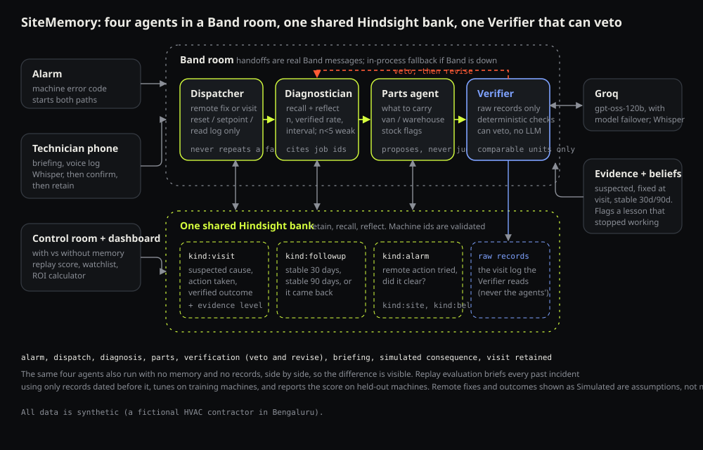
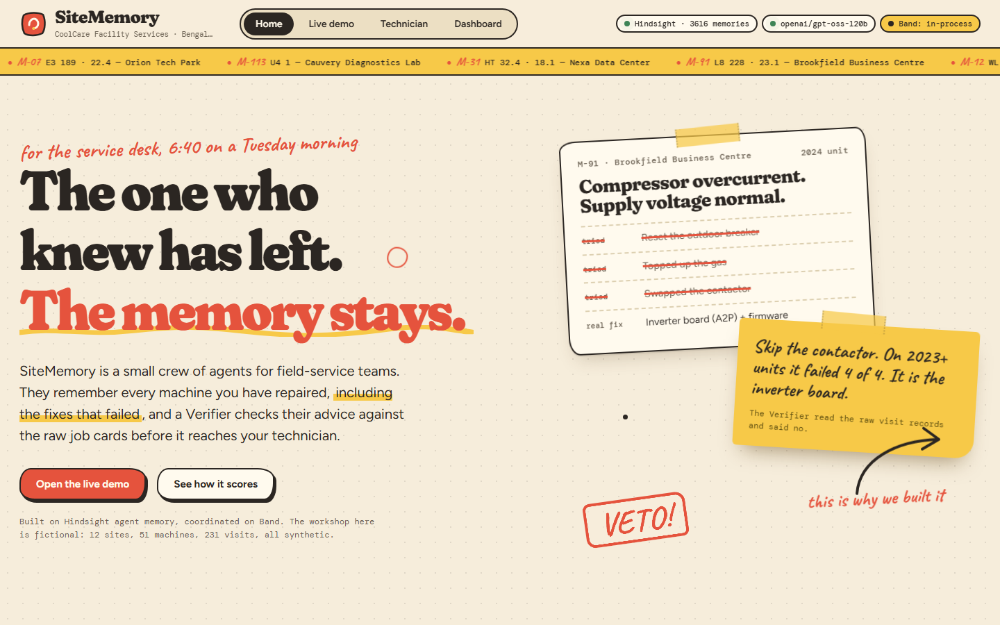
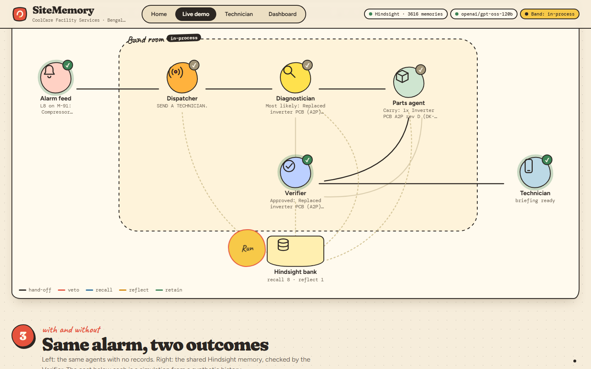
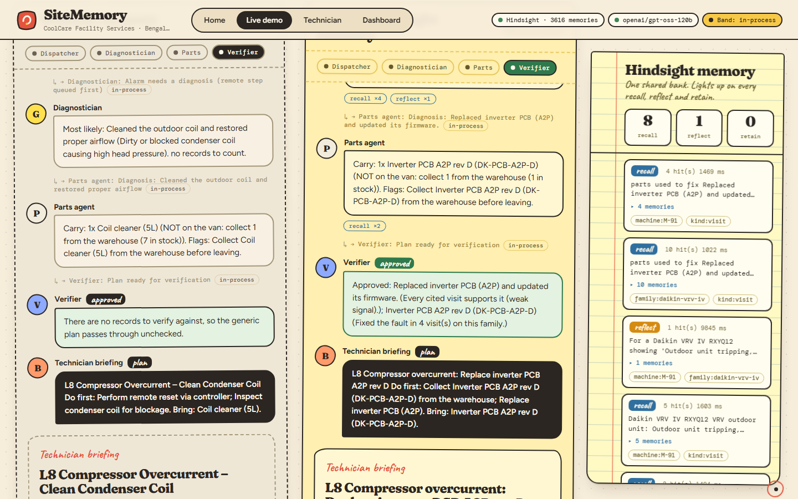
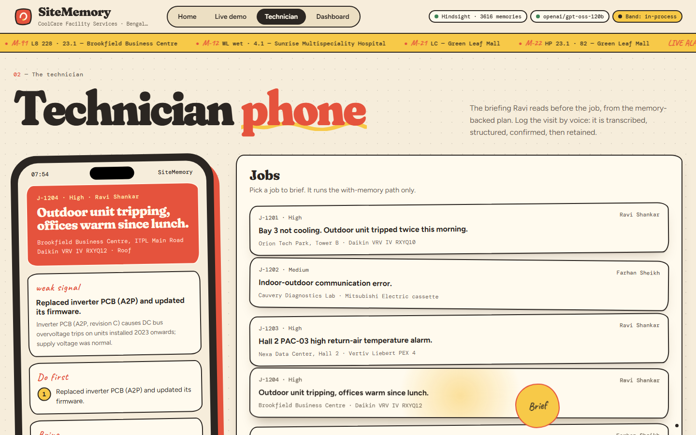
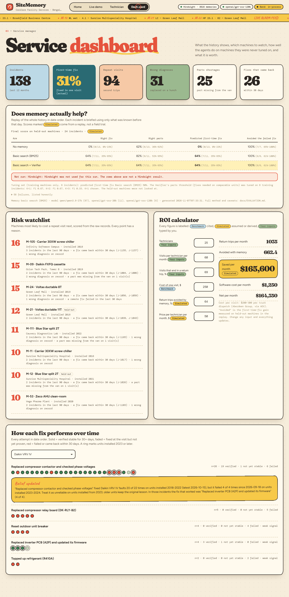

# SiteMemory

**Field-service agents that remember every machine, every site and every repair, check each other against the raw records, and say how sure they are.**

An alarm comes in. Four agents in a [Band](https://band.ai) room (Dispatcher, Diagnostician, Parts agent, Verifier) turn it into a diagnosis, a parts list and a technician briefing, all on **one shared [Hindsight](https://github.com/vectorize-io/hindsight) memory bank**. The Verifier sees only the raw visit records, runs deterministic checks and can veto. The same agents also run with no memory, side by side, so you can see what memory changes.



| | |
| --- | --- |
|  |  |
| **Home:** the story in one page | **Live demo, the mesh:** hand-offs between the four agents and every Hindsight recall, reflect and retain |
|  |  |
| **Without vs with memory**, with the memory receipt | **Technician phone:** the briefing, and voice logging that retains |
|  | |
| **Dashboard:** replay score, risk watchlist, ROI calculator | |

*Screenshots were captured on real Hindsight recalls while the Groq free-tier daily token limit was spent, so the agents ran in their no-model backup mode (ranking by the verified record). The Verifier veto path with the language model on is shown in the live demo and covered by the tests.*

## The problem

A repeat visit costs a service company a technician's day, fuel, an SLA penalty or a customer. What prevents it (what failed on this unit last time, what finally fixed it, which part to carry, the gate code) lives in job cards, chat threads and the heads of people who leave. And plain "memory" is not enough: a log is full of wrong diagnoses, parts that were replaced on a hunch, fixes that held for three weeks, and fixes that quietly stop working on a newer generation of units. SiteMemory is built for that mess.

## What it does

1. **Four agents, one shared bank, on Band.**
   - **Dispatcher** decides *remote fix* or *send a technician*. Remote fixes are limited to a reset, a setpoint change or reading a log, and a remote fix that already failed on this machine is never repeated.
   - **Diagnostician** recalls and reflects, then proposes causes. It shows *n*, verified successes, the success rate and its 95% interval, computed from the raw records. Fewer than 5 attempts is labelled **weak signal**, and confidence is earned by verified outcomes, not by how fluent the answer is.
   - **Parts agent** proposes parts from past visits and checks van and warehouse stock. It does not judge whether the evidence is good enough.
   - **Verifier** sees only raw visit and alarm records, never the other agents' reasoning. Its checks are deterministic, so the same inputs always give the same verdict. A vetoed agent revises and the Verifier checks again.
2. **Evidence levels.** Every visit stores the suspected cause, the action taken and a verified outcome on a ladder: *suspected → fixed at visit → stable 30 days → stable 90 days*. A fix that comes back within 30 days never counts as fixed. Only verified outcomes raise confidence.
3. **Live demo (six acts on one page).** (1) An alarm comes in. (2) A live mesh diagram: Alarm feed, Dispatcher, Diagnostician, Parts, Verifier and the Technician in a Band room, each hand-off a travelling dot, each Hindsight recall, reflect or retain a coloured line to the bank. (3) Two paths side by side, without memory and with the shared Hindsight bank, ending in a **simulated consequence**; the Verifier's vetoes are stamped on screen. (4) **Drills**: switch Band, Hindsight or the main model off for one run and watch the backup take over (in-process agents, local keyword memory, next model; with every model down, the Diagnostician and Parts agent rank by the verified record). (5) **Self-learning**: log that the recommended fix failed, see it retained and the evidence counts change, then brief the same alarm again. (6) **Accuracy**: bars with intervals and a learning curve from the replay evaluation.
4. **Technician phone and voice logging.** The briefing on a phone, and a mic button: Groq Whisper transcribes the spoken visit, the LLM structures it, the technician confirms, then it is retained.
5. **Dashboard.** Replay evaluation score, a risk watchlist (every point has a stated reason), an ROI calculator in which every figure is labelled **Benchmark**, **Simulated** or **Your inputs**, and every fix's outcomes over time.
6. **Leak-proof replay evaluation.** Every past incident is planned using only records dated before it, a guard fails if a later record is present, the Verifier's one threshold is tuned on training machines only, and the final score is on held-out machines.

## How Hindsight memory is used

One bank per company. Every agent reads and writes the same bank; records are tagged by kind and appended in date order, never edited:

| Record | Tags | Holds |
| --- | --- | --- |
| Visit | `kind:visit`, `machine:`, `site:`, `family:`, `evidence:` | suspected cause, what was tried and whether it worked, parts used, parts missing, confirmed cause, the verified outcome at the time |
| Follow-up | `kind:followup`, `evidence:stable_30d` / `stable_90d` / `failed` | what happened afterwards: it held, or it came back |
| Alarm | `kind:alarm`, `code:` | the alarm, the remote action tried, whether it cleared |
| Site | `kind:site` | access rules and contacts |
| Belief | `kind:belief` | a correction, when a lesson stopped being true |

| Operation | When | Code |
| --- | --- | --- |
| `retain` | after every visit; follow-ups as they fall due; once per belief correction | `backend/records.py`, `app.py: _log_visit`, `beliefs.py: sync` |
| `recall` | before every decision, scoped with tags that must **all** match (`machine:M-07` + `kind:visit`) so alarms never pollute a diagnosis | `agents.py` |
| `reflect` | before every diagnosis: lessons across many visits, and whether the answer depends on how old the unit is | `agents.py: Diagnostician` |

Design points that made it work:

- **Machine ids are validated.** A record or a recall for a machine that does not exist is refused before it touches memory.
- **Failures are first-class.** Every attempt is retained as `DID NOT FIX IT` or `FIXED IT`, and a wrong diagnosis stays on the record, so the agents can say what to skip, not only what to do.
- **Every recommendation links to exact past visits.** Hindsight rewrites memories into facts, so job ids are not in the recalled text; the `document_id` it returns tags every memory (`[source J-0902, 2026-03-14]`), and a citation the records do not support is vetoed.
- **Counts come from the raw records, not from the model.** The LLM proposes; *n*, rates and intervals are computed deterministically, and the Verifier recomputes them.
- **Comparable units.** When the record splits by hardware generation, statistics and part support are computed on units like this one, so a fix that fails on 2023+ units does not drag down its record on 2019 units, and does not get approved for a 2024 unit on the strength of the old ones.
- **One event loop.** The Hindsight client is async and its sync wrappers fail inside web-server threads; every call goes through one background loop (`memory._LoopThread`). Before that fix, recall silently returned nothing and "memory on" looked identical to "memory off".
- **Graceful degradation, shown honestly.** If Hindsight is unreachable (no credit, outage), the app falls back to a local BM25 keyword memory kept in step, and a banner says so. It is never presented as Hindsight recall.

## The Verifier's checks

All deterministic, over raw records as of the alarm's date:

| Claim | Check | Veto when |
| --- | --- | --- |
| Remote fix | action type is reset / setpoint / read log; no failure of that action on this machine in 30 days | not allowed, or it already failed here |
| Cause | each cited job exists, is dated before the alarm, is the same model family, shows that fix as worked, and is not merely suspected | a citation is missing or does not support the claim |
| Cause | the fix's record on comparable units; recent evidence vs earlier | recent failures contradict the lesson (`Belief updated: ...`) |
| Part | the part fixed the fault in enough visits on comparable units | it was replaced without fixing the fault, or never used |

## Replay evaluation

<!-- RESULTS-START -->
| Arm | Predicted first-time fix | Right parts | Failed fix avoided |
| --- | --- | --- | --- |
| No memory | **0% (0/13, 95% 0%-23%)** | 62% (8/13, 95% 36%-82%) | 100% (7/7, 95% 65%-100%) |
| Basic search (BM25) | **64% (7/11, 95% 35%-85%)** | 82% (9/11, 95% 52%-95%) | 100% (6/6, 95% 61%-100%) |
| Basic search + Verifier | **64% (7/11, 95% 35%-85%)** | 64% (7/11, 95% 35%-85%) | 100% (6/6, 95% 61%-100%) |

Simulated: a replay of a synthetic history, scored on 24 incidents on 8 held-out machines that were never used for tuning. Generated 2026-11-07 07:33 with basic search (BM25). Not run: Hindsight: Hindsight was not used for this run. 94 of 179 model calls came back empty (rate limits); those runs are excluded from the rates, so the intervals are wide.

On basic search, the Verifier changed predicted first-time fix from 64% to 64%.

Method, tuning and every failure: [docs/EVALUATION.md](docs/EVALUATION.md).
<!-- RESULTS-END -->

## Self-correcting memory

The history contains a drift: the compressor-contactor swap fixed Daikin VRV IV trips on units installed 2018 to 2022, then failed every time on units installed 2023 and later, where the real cause was the inverter board. `backend/beliefs.py` notices this with a rule you can read in one screen:

```python
MIN_EARLIER, MIN_RATE, MIN_RUN, ALPHA = 4, 0.75, 2, 0.05

def detect(att):  # attempts of one fix on one model family, in date order
    r = 0
    for a in reversed(att):                        # 1) the latest attempts all failed
        if a["result"] in GOOD: break
        r += 1
    earlier, recent = att[:len(att) - r], att[len(att) - r:]
    if r >= MIN_RUN and len(earlier) >= MIN_EARLIER:
        k, n, p = _p(earlier)                      # Laplace-smoothed earlier success rate
        if k / n >= MIN_RATE and (1 - p) ** r < ALPHA:     # r failures in a row would be a <5% accident
            return {"earlier": earlier, "recent": recent, "cohort_from": None, ...}
    for y in sorted({a["installed"] for a in att})[1:]:    # 2) one generation of units fails, older units do not
        new, old = [a for a in att if a["installed"] >= y], [a for a in att if a["installed"] < y]
        if len(new) >= MIN_RUN and all(a["result"] not in GOOD for a in new) and len(old) >= MIN_EARLIER:
            k, n, p = _p(old)
            if k / n >= MIN_RATE and (1 - p) ** len(new) < ALPHA:
                return {"earlier": old, "recent": new, "cohort_from": y, ...}
```

It scopes the belief to the units that fail, names the fix that worked in those incidents, retains the correction to Hindsight, and lets the Verifier veto a recommendation the newer evidence contradicts. The dashboard plots every fix's outcomes over time. If the fix starts working again, the belief disappears.

## Run it

Requires Python 3.11+.

```bash
python -m venv .venv
.venv/Scripts/activate            # Windows. On macOS/Linux: source .venv/bin/activate
pip install -r requirements.txt
cp .env.example .env              # add GROQ_API_KEY and HINDSIGHT_API_KEY (and the BAND_KEY_* values, optional)
python backend/app.py             # http://localhost:8000
```

On first start the app seeds the shared bank (about 640 records; allow a few minutes for Hindsight to finish processing). With no Hindsight key, or if Hindsight cannot be reached, it runs on the local keyword memory and says so.

```bash
python -m pytest tests -q            # 60+ tests, no network or keys needed (fake LLM, local memory, mock Band server)
python scripts/run_eval.py           # the replay evaluation on real Groq (and Hindsight, if reachable)
python scripts/generate_data.py      # regenerate the synthetic company (deterministic)
python scripts/check_content.py      # submission-rule checks (banned word, post length, links, secrets)
```

**Band:** create four remote agents in the Band app and paste their keys into `.env`. Step by step, with what is and is not verified, in [docs/BAND_SETUP.md](docs/BAND_SETUP.md). Without keys the same four agents run in-process.

## Failure handling

- LLM rate limit or outage: a per-minute limit is waited out; a daily limit moves straight to the next of three Groq models; if all fail, the agent says "unknown" and the Verifier will not approve it. In the evaluation, runs where the LLM failed are excluded from the rates, never scored as wrong answers.
- Hindsight unreachable: local BM25 fallback, with a visible banner.
- Band unreachable or misconfigured: the run continues in-process and the room says so.
- Bad audio, silence, an unreadable file or an extraction failure: specific messages and a type-instead fallback; nothing is saved without confirmation.
- An invented machine id, a citation that does not exist, a part the records do not support: refused or vetoed, never shown as fact.

## Layout

```
backend/   app.py (API + SSE)  agents.py (Dispatcher, Diagnostician, Parts, Verifier)  evidence.py  records.py  memory.py  traced.py
           beliefs.py  plan.py  simulate.py  evaluation.py  watchlist.py  voice.py  llm.py  store.py
           mesh/  band.py (Band REST client + room)  runner.py (control room, two paths)
           data/  synthetic company, machines, sites, history, alarms, stock, scenarios; eval_results.json
frontend/  index.html (the whole UI, no build step)
scripts/   generate_data.py  run_eval.py  check_content.py
tests/     agents + Verifier + control room, Band (mock server), evidence levels, evaluation (leakage), voice
docs/      architecture.svg  BAND_SETUP.md  EVALUATION.md  VIDEO_SCRIPT.md  ARTICLE.md  LINKEDIN_POST.md  screenshots/
```

## Data

All data is synthetic: a fictional Bengaluru HVAC contractor (CoolCare Facility Services) with 12 sites, 51 machines (8 held out for testing only), 6 technicians, about 230 visits in about 137 incidents, 180 alarms with remote-fix outcomes, and parts stock. It deliberately contains wrong diagnoses, failed first attempts, parts shortages, fixes that came back within 30 days, and a fix that stops working on newer units. No real company, person or customer.

## Limitations and roadmap

- **Hindsight credit.** The Hindsight bank needs credit to ingest and recall. When the credit ran out during development, every Hindsight-dependent number was produced on the local fallback or marked **not run**; see [docs/EVALUATION.md](docs/EVALUATION.md) for exactly what ran. Top up and rerun `python scripts/run_eval.py` to add the Hindsight arms.
- **Band is untested against the live service.** The transport follows Band's published OpenAPI schemas and is tested against a mock server; a first live run needs your four agent keys ([docs/BAND_SETUP.md](docs/BAND_SETUP.md)).
- **Everything labelled Simulated is an assumption or a replay**, not a measurement: the consequence of a plan, hours and downtime per visit, and the ROI "avoided return trips". The $200-300 cost of a truck dispatch is a cited benchmark (Aberdeen Group, via AEX); the rest are ours.
- **Small, synthetic evaluation.** Read the direction, not the percentage; the intervals are in the report.
- **Remote fixes are decided by rules over the alarm log and are not driven on a real building management system.**
- **Whisper mishears brand names** (a spoken "Daikin" can come back as "Dakin"); the confirmation step exists for that reason.
- **Roadmap:** a native phone app with offline mode; a real BMS integration for the remote step; one bank per company in a multi-tenant deployment; letting the Verifier's thresholds be set per company; field trials in place of replays.
