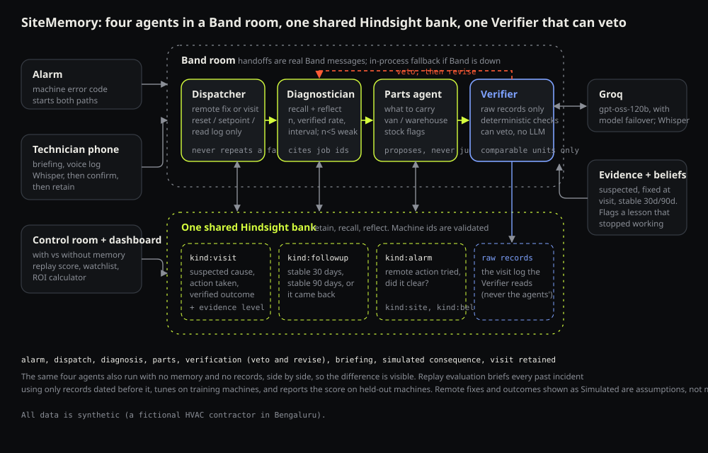

<!--
DRAFT FOR A TEAM MEMBER TO ADAPT. Every member publishes their own article (800-1500 words) on Medium, Dev.to, Hashnode, Substack or
LinkedIn Articles (public; not Google Drive). Change the opening, add your own role and one thing you learned, and keep the numbers
exactly as docs/EVALUATION.md states them. Upload docs/architecture.svg (export as PNG) and the screenshots in docs/screenshots/.
Do not use the event-type word anywhere (title, body, tags). Then share the link on r/llmdevs, r/sideproject, r/aiagents or r/aimemory.
Required links are already in the text: github.com/vectorize-io/hindsight, hindsight.vectorize.io, vectorize.io/what-is-agent-memory.
-->

# Teaching a repair agent what failed, with Hindsight

A technician drives forty minutes to a rooftop AC unit that keeps tripping. He resets the breaker. He tops up the refrigerant. The unit runs for twenty minutes and trips again. The real cause was a burnt compressor contactor, a part that sat in the warehouse the whole time. The person who knew that had fixed the same unit in March and August, and had since left the company.

I built SiteMemory so the second trip doesn't happen. It is a set of agents for field-service teams that remember every machine, every site and every repair, and, the part I care about most, remember what **didn't** work.

## The problem, concretely

A repeat visit costs a service company a day of a technician's time, fuel, a missed slot for another customer and sometimes an SLA penalty. The knowledge that prevents it lives in paper job cards, chat threads and people's heads. Every new ticket starts from "Office AC not cooling" and nothing else.

I used a fictional Bengaluru HVAC contractor with 25 machines at 9 sites, 67 visits over 43 incidents, and 78 machine alarms with the remote fixes that were tried. All synthetic, but written to look like a real service log: voltage readings, part numbers, a facility manager who only answers the phone before ten.



## Where Hindsight fits

Each of the four agents has its own [Hindsight](https://github.com/vectorize-io/hindsight) memory bank, holding only what that role needs. The Dispatcher remembers alarms and whether a remote fix cleared them. The Diagnostician remembers full visit records. The Parts agent remembers which parts fixed which faults, and when a missing part forced a second trip. The Field assistant remembers sites and visits. If you want the background on agent memory itself, [this explainer](https://vectorize.io/what-is-agent-memory) is a good start, and the [Hindsight docs](https://hindsight.vectorize.io/) cover the API.

The three operations map directly onto the workflow:

- **retain** after every visit: what was tried, what failed, what worked, the root cause, the parts. A failure is stored as `DID NOT FIX IT`, not dropped.
- **recall** before every job, scoped with tags: `machine:M-07` (this exact unit), `family:daikin-vrv-iv` (the same model at other sites) and `site:S-01` (gate codes, contacts). The family tag is how a site with no history still gets a useful briefing.
- **reflect** before every diagnosis, to turn many visits into lessons: "the reset failed twice, the contactor fixed it both times, supply voltage dips to about 190 volts."

The wrapper is small. The one non-obvious part is that Hindsight's client is async, and its sync wrappers fail inside web-server threads, so every call goes through one background event loop:

```python
def recall(self, query: str, tags: list[str], limit: int = 6) -> list[Memory]:
    resp = self._io.run(self.client.arecall(
        self.bank_id, query, tags=tags or None, tags_match="any", budget="mid", max_tokens=2048))
    out = []
    for r in (resp.results or [])[:limit]:
        meta = dict(r.metadata or {})
        if getattr(r, "document_id", None):
            meta["document_id"] = r.document_id      # lets agents cite the visit this fact came from
        out.append(Memory(r.text, list(r.tags or []), str(r.occurred_start or "")[:10] or None, 0.0, meta))
    return out
```

## Before and after

The same job, the same model, only memory changes. Ticket: "Bay 3 not cooling. Outdoor unit tripped twice this morning."

**Without memory** (confidence: low): likely cause "possible high head pressure or refrigerant issue causing the unit to trip". Do first: *read the fault code, reset the outdoor unit, inspect the condenser for debris, verify the power voltage.* Bring: *multimeter, refrigerant pressure gauges, a cleaning brush, spare fuses.* Sensible, generic, and it starts with the reset that had already failed on this unit.

**With memory** (confidence: high): likely cause "burnt compressor contactor caused by supply voltage dips (about 190 V)". Do first: *verify supply voltage, replace the compressor contactor (DK-CTR-24V).* Don't repeat: *breaker reset (already failed), refrigerant top-up (ineffective).* Bring: *the DK-CTR-24V contactor.* Site notes: *contact the facility manager before arrival.*


## When memory goes stale

Remembering is the easy half. A fix that worked nine times can quietly stop working when a new hardware revision arrives, and an agent that only remembers the old successes keeps sending technicians to repeat it.

In my data the contactor swap fixed Daikin VRV IV trips 9 of 9 times on units installed 2018 to 2021, then failed 4 of 4 times on units installed 2023 and later, where the real culprit was the inverter board. The agent tracks every fix's outcomes per model family, and uses a rule rather than a hunch: if the trailing failures of a fix would be a fluke (under 5%) given its earlier record, the lesson is contradicted. The belief is scoped to the cohort that fails, names the fix that did work, is retained back into Hindsight, and shows up in the briefing:

```python
k, n = sum(1 for a in earlier if a["result"] == "worked"), len(earlier)
if k / n < MIN_RATE or (1 - (k + 1) / (n + 2)) ** r >= ALPHA:
    return None   # not a contradiction. Otherwise r failures in a row would be a fluke, and the belief is flagged
```

For a 2019 unit the agent still says contactor. For a 2024 unit it says check the inverter board first and warns that the contactor swap failed 4 of 4 times on that generation.


## Did it actually help?

I didn't want to rely on a good-looking demo, so I replayed the whole history in date order. Every incident is briefed twice with the same agent and model: once from the ticket alone, once from a fresh memory bank containing only visits dated before that incident. Each visit is added only after its incident is scored, and the harness asserts that nothing from the future leaks in. Briefings are scored against what really happened: did it recommend the fix that worked, warn against the attempts that failed, and name the right part?

Over {{N}} incidents, the predicted first-time-fix rate was **{{FTF_WO}} without memory and {{FTF_W}} with it**. The fix was recommended {{FIX_WO}} of the time without memory and {{FIX_W}} with it; the briefing warned off the attempts that really failed {{WARN_WO}} versus {{WARN_W}} of the time.

{{CURVE_NOTE}}

## What I'd tell you before you copy this

- **My first version silently did nothing.** Recall failed inside the web server's worker threads, the agent caught the error and carried on without memory, and "memory on" looked identical to "memory off". I only noticed because I compared the two side by side. Make the failure visible.
- **Memories lose their ids.** Hindsight rewrites what you retain into facts, so a job number in your text may not come back. I cite visits using the `document_id` it returns, and discard any evidence an agent cites that wasn't actually recalled.
- **The evaluation is small and synthetic.** {{N}} incidents is enough to see a direction and not enough to quote a percentage to a decimal place; the confidence intervals are in `docs/EVALUATION.md`. The judge is an LLM from the same family as the agent, so I also score every briefing with a plain keyword matcher and report how often the two agree.
- **Early incidents can't benefit.** With no history there is nothing to recall, and the numbers show it. That is the honest shape of a learning curve.

The code, the data generator and the evaluation are in the repository, and everything here can be rerun: [github.com/YOUR-ACCOUNT/sitememory](https://github.com/YOUR-ACCOUNT/sitememory).
